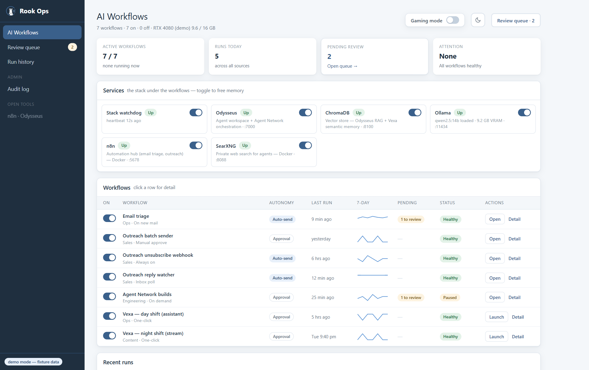
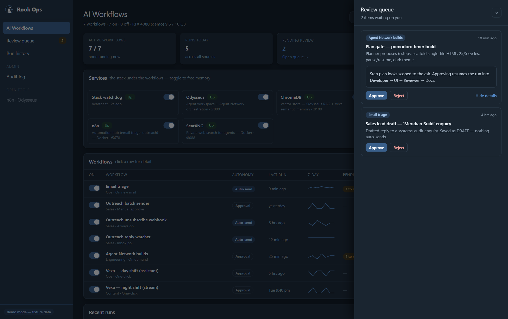
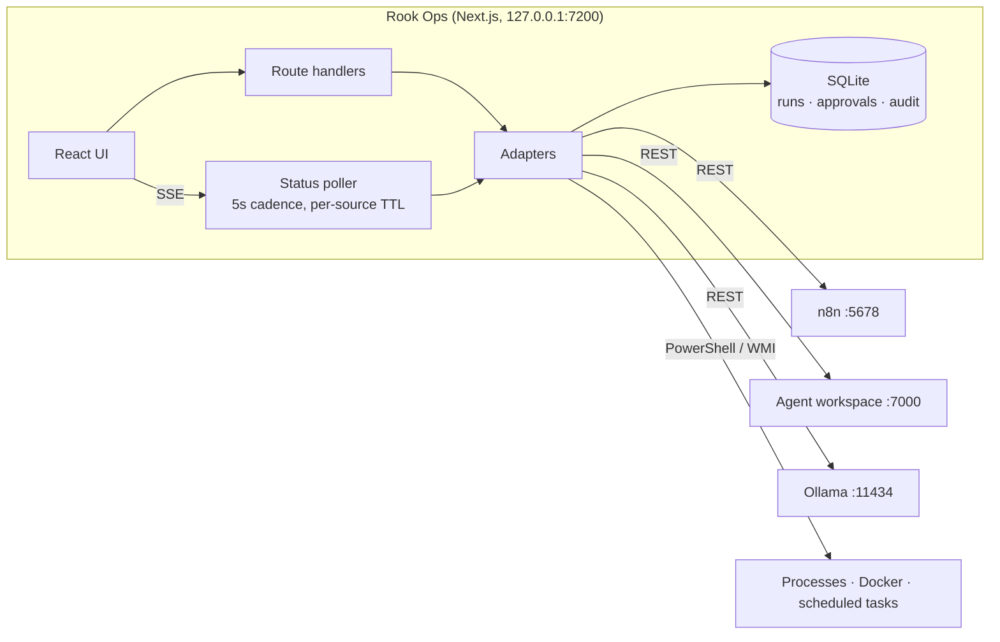
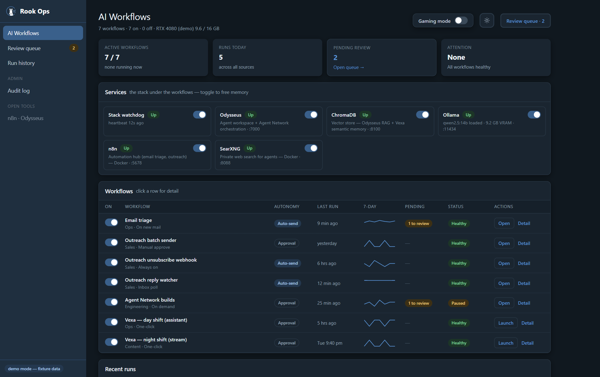
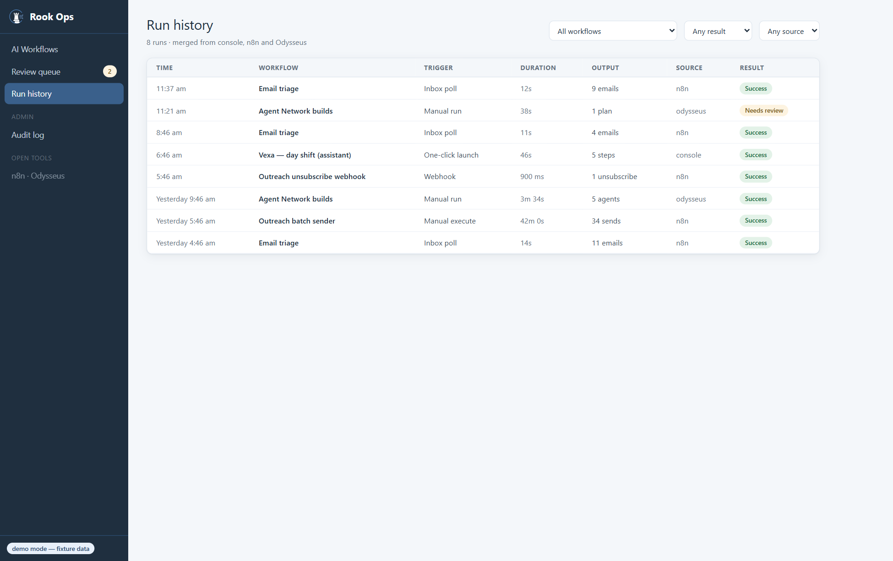

# Rook Ops

**A local-first control plane for a home AI stack.** One dashboard to see and control every AI workflow on the machine: flip services off to free VRAM for gaming, clear pending approvals from a unified review queue, and launch multi-program setups (a VTuber rig) with one click.



This is the operator console for my actual homelab: an [n8n](https://n8n.io) automation hub (email triage, cold-outreach pipeline), a self-hosted agent workspace with approval-gated multi-agent runs, [Ollama](https://ollama.com) local models, ChromaDB, and an AI VTuber. The console does not replace any of those — it gives them one pane of glass, one review queue, and one kill switch.

## Why it exists

Running an AI homelab means a dozen processes fighting over 16 GB of VRAM, approvals scattered across four UIs, and "did the email triage run last night?" requiring three tabs. And when it's time to play a game, the stack needs to *get out of the way* — including the watchdog that exists specifically to resurrect anything that dies.

## What it does

| Feature | How |
|---|---|
| **Live service control** | TCP/process/Docker probes every 5s, pushed over SSE. Toggle any service: Ollama (unloads models first), ChromaDB (Windows scheduled task), Docker containers, watchdog (killed by command-line match, relaunched via WMI so it survives session teardown) |
| **Gaming mode** | One switch. Sets a flag the watchdog honours *first* (otherwise it would revive everything within 60s), unloads and stops Ollama, stops the agent workspace + vector store + containers, then reports exactly how much VRAM/RAM it freed via `nvidia-smi` before/after |
| **Unified review queue** | Agent-workspace approval gates (approve / send back with feedback via its REST API) and outreach-campaign "ready to send" notices in one drawer, sourced live |
| **Run history** | Console actions, n8n executions and agent runs merged into one filterable timeline |
| **One-click launchers** | Ordered steps with preflight + wait conditions: vector store → models → VTube Studio (via Steam) → OBS → the VTuber process, each step streamed to the UI as it goes |
| **Audit log** | Every toggle, launch, approval and gaming-mode switch is recorded |



## Architecture



- **Next.js 16** (App Router, TypeScript), Tailwind v4, hand-rolled design system (light + dark)
- **Drizzle + better-sqlite3** for runs/approvals/audit — zero external services
- **SSE** for live updates (no websocket infra), an in-process poller with per-source cache TTLs
- **Adapter model**: every integration is a small module behind a common registry (`src/lib/registry.ts` declares *what*; `src/lib/adapters/*` implement *how*). A future remote host (NVIDIA DGX Spark running specialized agents) plugs in as another adapter target — the schema carries a `host` column from day one.
- **Windows-native control**: PowerShell/CIM for process discovery (with patterns "shattered" so concurrent probes can never match each other's command lines — a fun bug), WMI `Win32_Process.Create` for launches that must outlive the console.

## Safety model

- Binds **127.0.0.1 only**. No auth, because it is never reachable off-box. Putting it on a network requires adding auth first.
- Secrets live in `.env.local`; machine paths in `config/local.json` (both gitignored, examples committed).
- **No PII in the repo or its database** — the outreach adapter reads aggregate counts only; email content never leaves the systems that own it.
- The cold-email batch sender deliberately has **no send button here**: sending stays a manual, human action in n8n. The console only surfaces readiness and deep-links.
- Every state-changing action is audited.

## Demo mode

`DEMO=1` swaps every adapter for seeded in-memory fixtures — same UI, no hardware, deploys anywhere (that's what the screenshots show). The live mode drives the real machine.

```bash
pnpm install
cp .env.example .env.local        # add keys when integrating n8n / the agent workspace
pnpm dev                          # dev server with hot reload -> http://127.0.0.1:7210

DEMO=1 pnpm dev                   # fixture data, no local stack needed
pnpm test                         # vitest unit tests (adapters, parsers)
```

## Deploying (always-on, one command)

Production runs as a detached background service on **:7200** from Next's
`output: "standalone"` bundle — no terminal window, survives the shell that
started it (WMI-parented), SQLite + config anchored to the repo root so
rebuilds never touch your data.

```bash
powershell -ExecutionPolicy Bypass -File deploy/update.ps1
```

That one command is the whole deploy: `git pull` → install → build → assemble
bundle → restart. Iterating is: edit (or let an agent edit) → push → run
`update.ps1`. Two more scripts:

- `deploy/start.ps1` — (re)start the last build; idempotent, safe to run any time
- `deploy/install.ps1` — one-time: autostart at logon + a **"Rook Ops" desktop
  shortcut** that opens the console as an Edge app window (no tabs, no address
  bar — a native-app feel without shipping Electron)

Dev (`:7210`) and production (`:7200`) coexist, so you can hot-reload changes
next to the always-on instance before deploying them.

## Screens

| | |
|---|---|
|  |  |

## Provenance

Designed in [Claude Design](https://claude.ai) (the mockup drove the token set and layout 1:1), built with **Claude Code** (Opus) operating my repos, docs and homelab directly, reviewed and steered by me. The interesting engineering is in `src/lib/adapters/` — real-world process control on Windows is where the bodies are buried.

MIT © Ryan · Rook Systems
